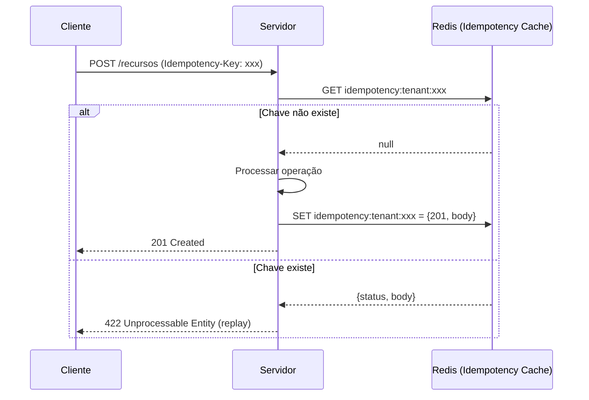
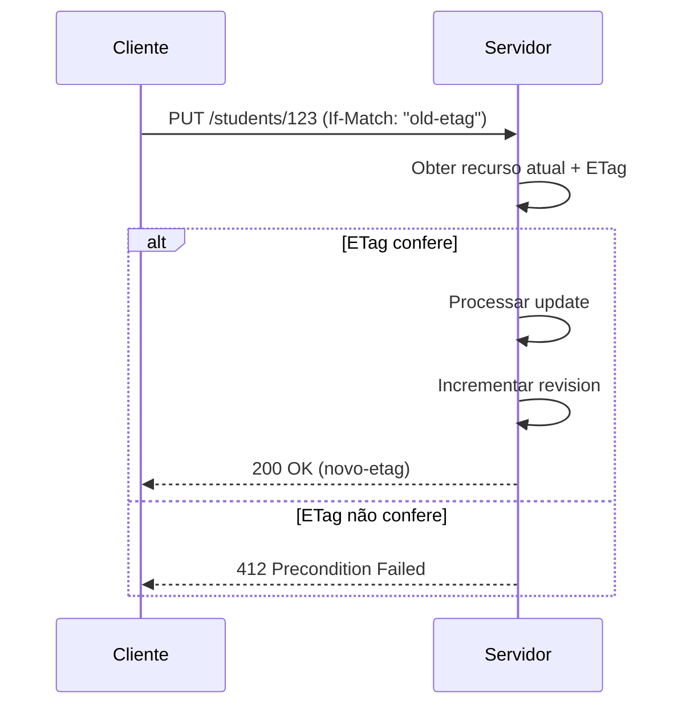
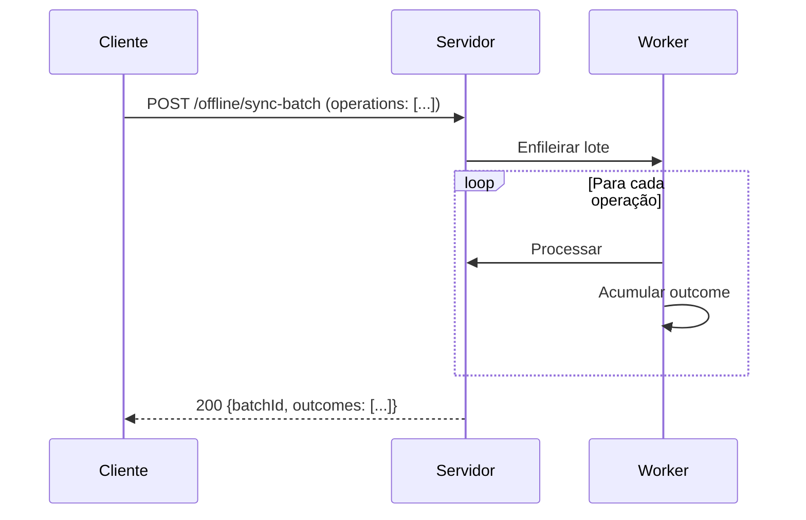

# Design: Contrato de Sincronização Offline

## Arquitetura

### Componentes

1. **Cliente Offline**
   - Gera `Idempotency-Key` baseado em UUID + HMAC
   - Armazena operações pendentes em local storage
   - Calcula desvio de relógio via `X-Server-Time`

2. **Middleware de Idempotência**
   - Cache distribuído (Redis) com TTL de 24h
   - Chave de cache: `idempotency:{tenant}:{key_hash}`
   - Valor: `{status_code, headers, body_hash}`

3. **Gerenciador de Revisão**
   - Coluna `Revision` em todas as entidades expostíveis
   - Update: `SET revision = revision + 1`
   - ETag gerado como: `SHA256(content + revision + version)`

4. **Processador de Lote**
   - Endpoint `/api/offline/sync-batch`
   - Processa operações sequencialmente
   - Acumula erros sem abortar
   - Resposta com outcomes detalhados

## Fluxos

### Fluxo 1: Operação Idempotente



### Fluxo 2: Conflito de Revisão



### Fluxo 3: Sync em Lote



## Schema de Dados

### Tabela de Cache de Idempotência

```sql
CREATE TABLE IdempotencyCache (
    key_hash TEXT PRIMARY KEY,
    tenant_id UUID NOT NULL,
    status_code INTEGER NOT NULL,
    headers JSONB,
    body_hash TEXT,
    created_at TIMESTAMP WITH TIME ZONE DEFAULT NOW(),
    expires_at TIMESTAMP WITH TIME ZONE
);

CREATE INDEX idx_idempotency_tenant ON IdempotencyCache(tenant_id);
CREATE INDEX idx_idempotency_expires ON IdempotencyCache(expires_at);
```

### Coluna de Revisão (exemplo para Student)

```sql
ALTER TABLE Students ADD COLUMN IF NOT EXISTS revision INTEGER NOT NULL DEFAULT 1;
ALTER TABLE Students ADD COLUMN IF NOT EXISTS version TEXT NOT NULL DEFAULT '1.0.0';
```

## Segurança LGPD

- Não armazenar corpo completo da requisição no cache
- Hash SHA-256 do corpo para verificação de replay
- Logs de sincronização apontam para `operations_metadata` (não PII)
- Retention policy de 24h no cache de idempotência

## Performance

- Cache Redis com LRU eviction
- Timeout de operação: 10s (batch) / 2s (individual)
- Rate limit: 100 req/min por tenant (sync batch)